# Hannes Göök

<picture>
  <source media="(prefers-color-scheme: dark)" srcset="out/header-dark.svg">
  <source media="(prefers-color-scheme: light)" srcset="out/header-light.svg">
  
</picture>

**Computer Science & Engineering (MSc) student at Chalmers University of Technology**

<picture>
  <source media="(prefers-color-scheme: dark)" srcset="out/award-dark.svg">
  <source media="(prefers-color-scheme: light)" srcset="out/award-light.svg">
  
</picture>

<picture>
  <source media="(prefers-color-scheme: dark)" srcset="out/dashboard-dark.svg">
  <source media="(prefers-color-scheme: light)" srcset="out/dashboard-light.svg">
  
</picture>

---

I build end-to-end **real-time control and machine-learning systems** across custom hardware and software: embedded firmware, wireless communication, computer vision, and reinforcement learning. I've been programming for 7+ years, and professionally since 2021, when I started my first internship at 15.

**Right now:** starting my MSc at Chalmers, and tuning altitude and position hold on [**KattVis**](https://github.com/hannesgook/kattvis), a GPS-free stereo-vision quadcopter.

## Featured projects

### KattVis &nbsp; 2026 to present · sponsored by PCBWay

**Stack:** ESP32, Raspberry Pi 5, OpenCV, Flutter, Unity, Fusion 360

A stereo-vision quadcopter that estimates its 3D position and motion **without GPS or a barometer**, using two onboard cameras and an IMU.

<table>
  <tr>
    <td width="50%"></td>
    <td width="50%"></td>
  </tr>
</table>

- Custom ESP32 flight controller with a cascaded PID loop at **250 Hz**, running independently of the vision workload
- Deadcat nylon airframe designed in Fusion 360, with a tuned front/rear roll-mix to compensate for the front motors' extra torque leverage
- Raspberry Pi 5 running an onboard stereo-vision and visual-odometry pipeline (dual OV9281 global-shutter cameras, 12 cm baseline)
- Custom Flutter ground station with the CAD-modeled airframe rendered live, PID tuning, a per-motor test mode, and built-in stereo calibration
- Prototyped the stereo pipeline in Unity before buying the physical cameras, to prove the approach first

**Status:** Manual test flights completed. Currently tuning altitude and position hold.

[**KattVis on GitHub →**](https://github.com/hannesgook/kattvis)

---

### PidraQRL &nbsp; 2025 to 2026 · team project · YSEA award

**Stack:** ESP32, PyTorch, Unity HDRP, Flutter, BLE, LoRa

A quadrotor built from scratch with a **live SAC reinforcement learning agent** tuning its roll-controller gains in real time, and a Unity HDRP digital twin mirroring live telemetry.

<table>
  <tr>
    <td width="50%"></td>
    <td width="50%"></td>
  </tr>
</table>

- Custom ESP32 flight controller with cascaded PID, Madgwick AHRS, and biquad filters (250 Hz loop)
- Full wireless chain: `Flutter app → BLE → Raspberry Pi → LoRa → ESP32` (+ direct BLE for RL)
- SAC RL agent (PyTorch) tuning PID gains in real time on the physical drone, **no sim-to-real transfer**
- Custom single-axis test rig for safe RL training with live propellers, plus a 3D-printed chassis designed in Fusion 360
- Unity HDRP digital twin with Fusion 360 models, mirroring live IMU telemetry over UDP

<b>What the jury said</b>

 

> *"The project stands out through a very high level of technical ambition. The custom-built flight controller, the distributed communication chain, and the well-designed failsafe solution demonstrate a deep understanding of real-time systems, control theory, and system safety. The methodology is exemplarily clear and reproducible."*
>  Research jury feedback, Unga Forskare 2026 (translated)

> *"In this project, the team members refused to take any shortcuts whatsoever. By rejecting ready-made frameworks and instead building everything from scratch, from communication to software, this work has demonstrated a technical dedication beyond the ordinary."*
>  Winners catalogue, Unga Forskare 2026 (translated)

<b>Press and links</b>

 

- [Official winners list (Swedish)](https://ungaforskare.se/wp-content/uploads/2026/04/alla-vinnare-uuf-2026.pdf) (Drone Control System)
- [Winners announcement with photos (LinkedIn, Swedish)](https://www.linkedin.com/posts/grattis-till-alla-fantastiska-pristagare-ugcPost-7443214290331017216-65qc?utm_source=social_share_send&utm_medium=member_desktop_web&rcm=ACoAAExydk8B2cZze4JlFAEzUhzplSSweQ-0wBE)
- [Digital exhibition](https://events.projectboard.world/ungaforskare2026/project/222684)
- [Hulebäcksgymnasiet news (Swedish)](https://hulebacksgymnasiet.harryda.se/nyhetsarkiv/2026-02-27-tavlar-med-egenbyggd-dronare)
- [School video (Swedish)](https://youtu.be/nFjXQu7kyrs?si=i-YoVVQbaT2_d_f_)
- [Local press (Swedish)](https://www.lokalpressen.se/hulebackselever-till-final-i-forskningssm-6.2.6460.2d8ea205e6)

[**PidraQRL on GitHub →**](https://github.com/hannesgook/PidraQRL)

---

### GDForge &nbsp; 2025 to 2026

**Stack:** Python, PyQt, audio analysis, reverse engineering

Generates a **playable Geometry Dash level from any song** using beat detection and physics simulation.

<table>
  <tr>
    <td width="50%"></td>
    <td width="50%"></td>
  </tr>
</table>

- Cube mode simulates ballistic arc physics reverse-engineered from observed in-game behavior
- Wave mode generates a diagonal path with rails and ramps sampled by arc length
- Reverse-engineered the `.gmd` format used by the GDShare mod to write valid level files importable directly into GD
- PyQt GUI with synchronized audio waveform and level geometry preview

[**GDForge on GitHub →**](https://github.com/hannesgook/gdforge)

## More projects

| Project | What it is | Link |
|---|---|---|
| **TramRush**  "Most Potential" award, IT Master Game Jam, Chalmers 2026 | 3-day jam, team of 3, theme "Gothenburg": drive a tram balanced on a single rail through a procedurally generated Gothenburg. **My role:** the map pipeline. It imports OpenStreetMap data (Overpass → GeoJSON) and builds the city in 3D in Unity, with real shops on buildings, tram stops from the data, and terrain from a Gothenburg heightmap. | [Repo](https://github.com/hannesgook/game-jam-chalmers-26) |
| **Gothenburg Flood Simulator**  Lovable Buildathon, Chalmers 2026 | 3D web app, built in 2 hours, showing how sea-level rise could affect Gothenburg. Pick a year and a scenario to see the water reach buildings. It combines Lantmäteriet 1 m terrain data, OpenStreetMap buildings, and SMHI water-level projections. | [Live demo](https://flood-sim.lovable.app/) |

## Work experience

**Software Developer, CPAC Systems** · 2021 to 2025 (recurring)

Five paid internships over four years, starting at age 15, building internal tools and simulators in C#, Python, and Unity.

- Optimized a Unity machine simulator, **doubling frame rate**
- Built a Python diagnostics tool adopted by senior engineers for root-cause analysis
- Developed machine simulations with custom mesh generation in Unity
- Built a license management service (HTML, CSS, JS)
- Refactored a Perl codebase and contributed to a web application (HTML, SCSS, TypeScript)

## Education

- **MSc in Engineering, Computer Science and Engineering** (Civilingenjör Datateknik), Chalmers University of Technology · 2026 to present
- **Upper secondary, Technology & Science**, Hulebäcksgymnasiet, Mölnlycke · 2023 to 2026

## Tech stack

 

 

| Area | Skills |
|---|---|
| **Languages** | Python, C++, C#, Dart, TypeScript, HTML/CSS |
| **Embedded systems** | ESP32, Arduino, real-time PID control, Madgwick AHRS / IMU filtering, MCPWM, BLE, LoRa |
| **Computer vision** | OpenCV, stereo vision, visual odometry, feature tracking, camera calibration |
| **AI / ML** | PyTorch, reinforcement learning (SAC), YOLO, synthetic data generation, local LLM inference, RAG (foundational) |
| **Simulation & graphics** | Unreal Engine, Unity (HDRP), procedural generation, dual contouring, marching cubes, perlin noise, Blender, Fusion 360 |
| **Apps & web** | Flutter, React |
| **Human languages** | Swedish (native), English (fluent), French (basic) |
